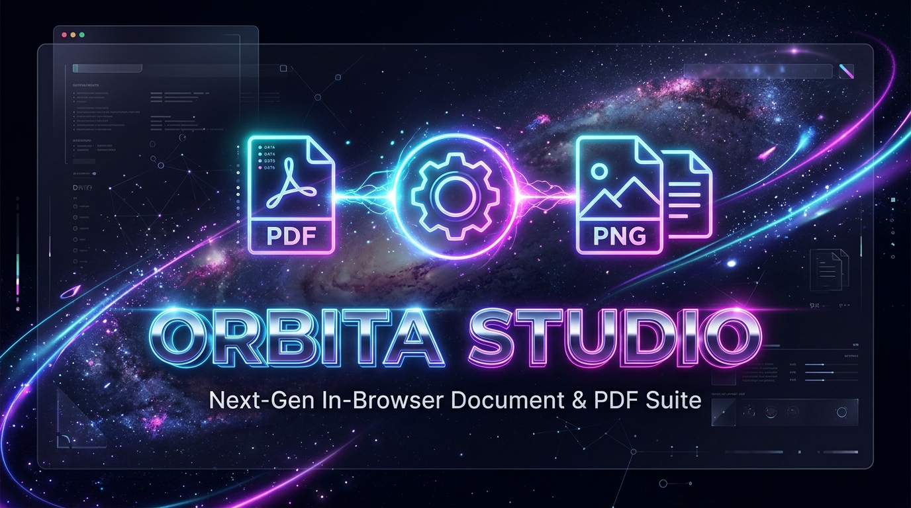

<p align="center">
  
</p>

<p align="center">
  <strong>⚡ Next-Gen All-in-One Multimedia, Video Downloader, Document & PDF Processing Suite.</strong><br>
  <em>Direct In-Browser RAM • Social Video Downloads • Native Office Engine • Enterprise Privacy</em>
</p>

<p align="center">
  
  
  
  
  
</p>

---

## 🌟 Overview (ภาพรวมระบบ)

**ORBITA Studio** is an ultra-fast, privacy-first multimedia and document processing powerhouse. It unifies professional PDF operations with cutting-edge social media video downloads, FFmpeg video/audio transcoding, rich in-browser Microsoft Word editing, and batch image conversions under a sleek cosmic glassmorphic UI.

- 🚀 **Zero Data Leakage:** High-security document and media processing without cloud lock-in.
- 🎬 **Social Video Engine:** Direct extraction from TikTok, YouTube (up to 4K), Instagram Reels, and Facebook with live 0-100% progress.
- 🎵 **Studio Audio Transcoder:** Extract crystal-clear 320 kbps MP3 audio from any video.
- 📝 **Live Word Studio:** Type, format, and instantly export real `.docx` files or import existing documents.
- 🎨 **Cosmic UI/UX:** Dark/Light theme, English & Thai bilingual support, keyboard shortcuts (`/`), and drag-and-drop workspace.

---

## 🛠️ Complete Suite of 19 Professional Tools (เครื่องมือทั้งหมด)

### 🎬 Media & Video (สื่อและวิดีโอ)
| Tool | Format Badge | Description | Color Brand |
| :--- | :---: | :--- | :---: |
| **Social Video & Audio** | `TikTok • YT • IG • FB` | Download full HD video or extract studio MP3 (320k) from social links | `#f43f5e` Rose |
| **Video to MP3 (320k)** | `Video → MP3` | Extract studio-grade 320 kbps MP3 audio from any video format | `#8b5cf6` Violet |
| **Video Converter** | `MP4 • WebM • MKV` | Convert format, scale to 1080p/720p/480p, and compress video | `#06b6d4` Cyan |

### 📝 Office & Studio (ออฟฟิศและเอกสาร)
| Tool | Format Badge | Description | Color Brand |
| :--- | :---: | :--- | :---: |
| **Word Document Studio** | `Online .DOCX` | Full in-browser Word document editor with live word stats and `.docx` export | `#3b82f6` Blue |

### 📄 PDF & Document Suite (จัดการเอกสารและภาพ)
| Tool | Format Badge | Description | Color Brand |
| :--- | :---: | :--- | :---: |
| **Merge PDF** | `PDF → PDF` | Combine multiple PDF documents with custom queue & visual order | `#6366f1` Indigo |
| **Organize PDF** | `Reorder & Delete` | Drag-and-drop page reordering, duplication, rotation, and deletion | `#8b5cf6` Violet |
| **Sign PDF** | `Signature` | Draw digital signature and stamp onto pages with adjustable position | `#10b981` Emerald |
| **PDF to PNG** | `PDF → PNG` | Ultra HD 300 DPI vector-sharp image rendering | `#06b6d4` Cyan |
| **PDF to JPG** | `PDF → JPG` | Compressed, high-speed image page extraction | `#f59e0b` Amber |
| **Images to PDF** | `IMG → PDF` | Assemble PNG, JPG, and WEBP into unified multi-page PDFs | `#ec4899` Pink |
| **Batch Image to ZIP** | `IMG → ZIP` | Convert multiple images to PNG/JPG/WEBP with resize and package to ZIP | `#10b981` Emerald |
| **Compress PDF** | `Compress` | Reduce PDF file size while maintaining visual clarity | `#10b981` Emerald |
| **Protect PDF** | `Security` | Lock and encrypt PDF with 128-bit/256-bit password protection | `#e11d48` Rose |
| **Split PDF** | `PDF → Pages` | Split documents into individual single-page PDFs in a ZIP | `#8b5cf6` Violet |
| **Rotate PDF** | `Rotate 90°` | Permanently rotate pages by 90°, 180°, or 270° | `#059669` Teal |
| **PDF to Text** | `PDF → TXT` | Extract raw text and tables into structured TXT documents | `#3b82f6` Blue |
| **Excel to PDF** | `XLSX → PDF` | Transform `.xlsx`, `.xls`, and `.csv` into clean PDF reports | `#14b8a6` Teal |
| **Page Numbers** | `Add Numbers` | Stamp customizable `Page X of Y` onto document footers | `#f97316` Orange |
| **Watermark PDF** | `Watermark` | Stamp custom diagonal security text watermarks on all pages | `#d946ef` Fuchsia |

---

## 🚀 Getting Started (วิธีเริ่มใช้งาน)

### Prerequisites
- Node.js 18+
- Python 3.10+ (with `flask`, `yt-dlp`, `python-docx`, `pypdf`, `pillow`)
- FFmpeg installed

### 1-Click Launch (Windows)
Double-click `run.bat` or execute in PowerShell:
```powershell
.\run.ps1
```
> **No Y/N prompt on exit:** Press `Ctrl + C` anytime to immediately shut down cleanly.

### Manual Launch
```bash
# Terminal 1: Python Engine
python python_engine/server.py

# Terminal 2: Vite Frontend
npm install
npm run dev
```

- Frontend URL: **http://localhost:3003/**
- Backend API Engine: **http://localhost:5001/**

---

## 🔒 Security & Privacy Guarantee

```
[User Device / Browser]
       │
       ├─► (Client-side RAM: Canvas, PDF.js, pdf-lib, JSZip)
       │
       └─► (Local Native Engine: yt-dlp, FFmpeg, python-docx, pypdf)
             └─► http://localhost:5001 (Zero External Data Leaks)
```

© 2026 ORBITA STUDIO. All rights reserved.
