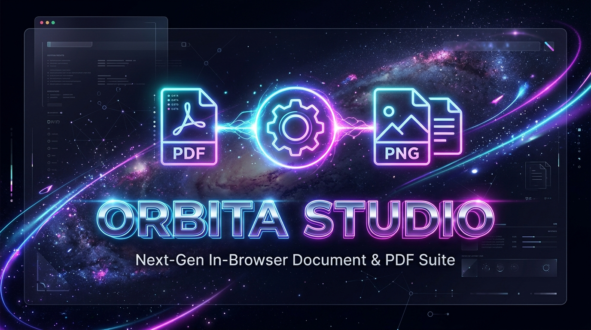

<p align="center">
  
</p>

<p align="center">
  <strong>⚡ A World-Class, 100% Client-Side In-Browser PDF & Document Conversion Suite.</strong><br>
  <em>Zero Server Latency • Zero Cloud Uploads • Enterprise-Grade Privacy • 100% Free Forever</em>
</p>

<p align="center">
  
  
  
  
  
</p>

---

## 🌟 Overview (ภาพรวมระบบ)

**ORBITA Studio** is an ultra-fast, privacy-first web document processing platform. Designed to outperform conventional cloud converters, ORBITA executes all conversions directly on the client's browser RAM using HTML5 Canvas, PDF.js, and WebAssembly.

- 🚀 **100% Client-Side:** Files never leave your computer or touch any external server.
- 🔒 **Zero Data Leakage:** Perfect for confidential legal contracts, bank statements, and private documents.
- ⚡ **No Limits & No Sign-up:** No accounts, no paywalls, and no upload timeouts.
- 🎨 **Modern UX/UI:** Fluid drag-and-drop page canvas with individual page rotations and batch processing.

---

## 🛠️ Complete Suite of Tools (เครื่องมือทั้งหมด)

| Tool | Format Badge | Description | Color Brand |
| :--- | :---: | :--- | :---: |
| **Merge PDF** | `PDF → PDF` | Combine multiple PDF documents with custom queue & visual order | `#6366f1` Indigo |
| **PDF to PNG** | `PDF → PNG` | Ultra HD 300 DPI vector-sharp image rendering | `#06b6d4` Cyan |
| **PDF to JPG** | `PDF → JPG` | Compressed, high-speed image page extraction | `#f59e0b` Amber |
| **Images to PDF** | `IMG → PDF` | Assemble PNG, JPG, and WEBP into unified multi-page PDFs | `#ec4899` Pink |
| **Split PDF** | `PDF → Pages` | Split documents into individual single-page PDFs in a ZIP | `#8b5cf6` Violet |
| **Rotate PDF** | `Rotate 90°` | Permanently rotate pages by 90°, 180°, or 270° | `#10b981` Emerald |
| **PDF to Text** | `PDF → TXT` | Extract raw text and tables into structured TXT documents | `#3b82f6` Blue |
| **Excel to PDF** | `XLSX → PDF` | Transform `.xlsx`, `.xls`, and `.csv` into clean PDF reports | `#14b8a6` Teal |
| **Page Numbers** | `Add Numbers` | Stamp customizable `Page X of Y` onto document footers | `#f97316` Orange |
| **Watermark PDF** | `Security` | Stamp custom diagonal security text watermarks on all pages | `#e11d48` Rose |

---

## 🚀 Live Demo & Getting Started (วิธีเริ่มใช้งาน)

### Prerequisites
- Node.js 18+ installed

### 1. Clone the repository
```bash
git clone https://github.com/satetapongsa/ORBITA_MERGE_PDF.git
cd ORBITA_MERGE_PDF
```

### 2. Install dependencies
```bash
npm install
```

### 3. Start local development server
```bash
npm run dev
```
> The development server will launch locally at **http://localhost:3003/**

### 4. Build for Production
```bash
npm run build
```

---

## ☁️ Deployment (Vercel)

This project is 100% pre-configured for instant one-click deployment on **Vercel**:

1. Fork or import this repository on [Vercel](https://vercel.com/new).
2. Framework Preset: **Vite**
3. Build Command: `npm run build`
4. Output Directory: `dist`
5. Click **Deploy**!

---

## 🔒 Security & Privacy Guarantee

```
[User Device]
      │
      ▼  (Local RAM Execution)
[PDF.js + pdf-lib + WebAssembly]
      │
      ▼  (Direct Blob Download)
[Converted Output File]

❌ No Cloud Storage
❌ No Remote Backend Processing
❌ Zero Tracking or Logging
```

---

## 📄 License
Open source under the [MIT License](LICENSE).
